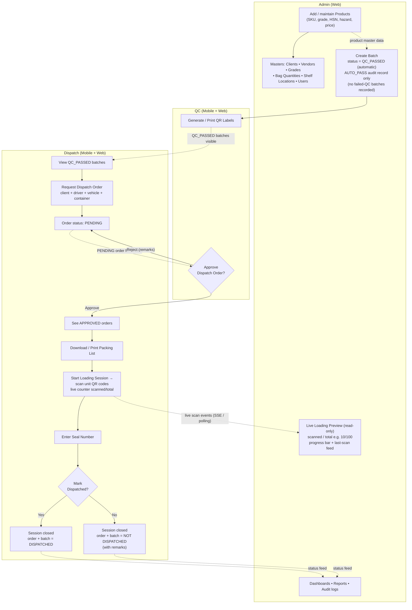

# Software Requirements Specification (SRS)
## Product Scanning & Dispatch Workflow System

| | |
|---|---|
| **Project** | ProductScanning — QC → Dispatch workflow |
| **Doc version** | 2.0 |
| **Date** | 29 Oct 2026 |
| **Status** | Approved for implementation |
| **Audience** | Any human developer, QA, BA — **or any AI agent** given this document plus the repository |

---

## 0. How to read / use this document (for implementers and AI agents)

This is a **self-contained, normative specification**. If you are implementing from this document:

1. **Sections marked MUST / MUST NOT / SHOULD** are binding requirements. Everything else is context.
2. §1–§5 define *what* to build (behaviour, rules, acceptance criteria). §6 defines *data shapes* (MongoDB + SQL, both provided; production uses **only one**, see §6.4). §6.5 defines *API contracts* verbatim — implement routes exactly as specified.
3. The existing codebase consistent with this document: `backend/` (Node.js + Express + TypeScript, JWT auth, role middleware), `frontend/` (React + Vite web app), `mobile/` + `mobile2/` (Expo apps for QC/DISPATCH scanning). Reuse existing patterns (controllers, mongo/mysql adapter files, sync service with `client_operation_id` idempotency, activity logging).
4. **Where this document conflicts with existing code, this document wins.** Known intentional conflicts are listed in §2.2 (behaviour changes) — the old QC pass/fail screen, admin dispatch-order approval, and dual-DB runtime mode are retired.
5. Acceptance criteria under each requirement (§5) are the definition of done. Implement all of them.

---

## 1. Introduction

### 1.1 Purpose
Specify the target end-to-end workflow of the ProductScanning system:

> **Admin adds products → QC creates batches (automatically QC-passed, no failed QC batches ever recorded) → Dispatch views batches and requests a dispatch order → QC approves the dispatch order → Dispatch downloads the packing list → Dispatch scans and loads the truck with a live loading preview visible to Admins (e.g. 10/100) → Dispatch enters a seal number and marks the batch DISPATCHED or NOT DISPATCHED.**

### 1.2 Scope
**In scope:** product master data; QC batch creation with auto-pass; dispatch order raise; QC approval; packing-list download; scan-based loading with live admin monitoring; seal number + final dispatched/not-dispatched marking; the data model and API for all of the above.

**Out of scope:** invoicing/GST billing, transportation/goods management beyond vehicle/driver/container fields, client-facing portal, accounting integrations.

### 1.3 Definitions

| Term | Meaning |
|---|---|
| **Batch** | A production lot of one product. Holds quantity, UoM, dates, shelf location, vendor, grade, bag quantity, and a unique `barcode_value`. |
| **QR label** | One printed sticker per unit/pack inside a batch (`qr_print_jobs` → `qr_labels`, unique `qr_value`). Scanned during loading. |
| **Dispatch order** | A request raised by DISPATCH for one batch: client, driver name, vehicle number, container number. |
| **Packing list** | Auto-generated, frozen line items for an approved dispatch order (product, batch, quantity, UoM, shelf location). |
| **Loading session** | A scan-driven loading run for one approved dispatch order. Tracks `scanned` vs `total` and drives the Admin live preview. |
| **Seal number** | Tamper-evidence number that DISPATCH must enter when finishing loading. |
| **UoM** | Unit of measure (kg, bags, litres, …). |
| **Roles** | `ADMIN`, `QC`, `DISPATCH` (JWT `role` claim; three user tables: `admins`, `qc_users`, `dispatch_users`). |

### 1.4 Normative language
- **MUST / MUST NOT** — mandatory; a build that violates it is non-conforming.
- **SHOULD** — strongly recommended; deviation must be justified in code comments.
- **MAY** — optional.

---

## 2. Overall Description

### 2.1 Current system context (what exists today)
- **Backend** (`backend/`): Express + TypeScript, port 3001, JWT access + refresh, `authenticate` + `authorize(role)` middleware, three role-specific user tables, offline-first sync service (`sync_operations`, idempotent via `client_operation_id`), activity logs, device registration, helmet/CORS/compression/rate-limiting, QR label printing pipeline (`qc/qr-jobs`), packing lists, reports/dashboards. Controller files exist in Mongo and MySQL variants (e.g. `batchController.mongo.ts` / `batchController.mysql.ts`) selected by DB config.
- **Web frontend** (`frontend/`): pages for Masters, Products, Clients, Vendors, Users, Batches, QC Dashboard/Scan, Dispatch Dashboard/Orders/Scan, PackingList, Reports, Dashboard.
- **Mobile** (`mobile/`, `mobile2/`): Expo apps with scanner-driven screens (batches, dispatch orders, scan tab) and offline sync support.
- **Existing flow (to be replaced):** production creates batches in `CREATED`; QC scans and records PASS or FAIL (failed batches recorded, reopenable); dispatch orders approved by ADMIN *or* QC; no loading sessions, no live preview, no seal number.

### 2.2 Intentional behaviour changes vs current code

| # | Current | Target (this SRS) |
|---|---|---|
| 1 | Admin manages products/master data | **Unchanged** (FR-01, FR-02) |
| 2 | Batch created in `CREATED`; QC later records PASS/FAIL; failed QC batches exist and can be reopened | **QC creates the batch directly in `QC_PASSED`.** The system MUST NOT record failed QC batches anywhere. An `AUTO_PASS` QC record is written for audit only. Endpoints for manual FAIL submit, bulk FAIL submit, and reopen-failed-batch are **removed**. |
| 3 | Dispatch order approved by ADMIN or QC | Approval/rejection is a **QC-only** action. Admin has read-only visibility of orders. |
| 4 | Packing list viewable on a web page | Dispatch MUST be able to **download** the packing list (PDF/print-ready) for approved orders. |
| 5 | Dispatch confirms dispatch per scan; no load tracking | Dispatch **starts a Loading Session**, scans unit QR codes with a live `scanned/total` counter, and Admin sees a **live preview** of every active session (e.g. **10/100**). |
| 6 | No seal number, no explicit "not dispatched" outcome | Dispatch **MUST** enter a **seal number** and mark the outcome **DISPATCHED** or **NOT DISPATCHED** (with remarks) to close the session; this updates order, batch, and dispatch-record state. |
| 7 | Backend runs in dual DB mode (MySQL or Mongo adapters) | **Single-database mode.** One of MongoDB or MySQL is chosen as the *only* datastore; the other adapter code path is retired. Schema design for both is provided in §6. |

### 2.3 User classes

| Role | Platforms | Capability summary |
|---|---|---|
| ADMIN | Web (+ mobile) | Products & masters, users, live loading monitor, reports/audit. **No order approval.** |
| QC | Mobile + web | Create auto-passed batches, print/reprint QR labels, approve/reject dispatch orders. |
| DISPATCH | Mobile + web | View QC-passed batches, raise dispatch orders, download packing lists, scan-load with counter, seal & finalise. |

---

## 3. Role Responsibilities (Deliverable 1)

### 3.1 ADMIN — "gatekeeper of master data and all-seeing monitor"
1. **Products:** add/edit/disable products with: name, description, SKU, price, quantity, CAS number, molecular formula, purity, grade, storage conditions, hazard classification, physical state, HSN code, manufacturer.
2. **Masters:** manage clients, vendors, grades, bag quantities, shelf locations (all with active/inactive flags). Grades and bag quantities feed QC's batch-creation dropdowns.
3. **Users:** create/administer QC and DISPATCH accounts (type = `admins` | `qc` | `dispatch`), activate/deactivate, reset passwords.
4. **Monitoring:**
   - All batches and current inventory state (read).
   - All dispatch orders and their statuses (read-only — MUST NOT approve/reject).
   - **Live loading preview:** every active loading session with `scanned/total` (e.g. **10/100**), % progress, last scan event + timestamp, duplicate/wrong-batch warnings; refresh latency ≤ 3 s (polling) or near-real-time (SSE).
   - Completed sessions: seal number, outcome (DISPATCHED / NOT DISPATCHED), remarks.
5. **Reports & audit:** dashboards, activity logs, QC history (PASS-only), dispatch history.

### 3.2 QC — "creator of good batches and approver of orders"
1. **Batch creation (auto-pass):** create batches against Admin-defined products. The batch MUST be created with status **`QC_PASSED`** and the system MUST simultaneously write one QC audit record (`result = PASS`, `method = AUTO_PASS`, tester = creating QC user). The system MUST NOT provide any UI or API to record a QC FAIL. If material is bad, QC simply does not create the batch (or deactivates/edits it before dispatch) — no failed-QC trace is retained.
2. **Labels:** generate QR print jobs per batch (quantity of unit labels), print and reprint labels.
3. **Batch upkeep:** edit batch details, finish-goods completion, assign shelf location, deactivate.
4. **Dispatch order approval:** review the PENDING queue of dispatch orders; each decision is **Approve** (order → `APPROVED`, batch → `DISPATCH_APPROVED`, packing list frozen) or **Reject** (order → `REJECTED` with remarks, batch returns to `QC_PASSED`).
5. Optionally view QC statistics.

### 3.3 DISPATCH — "hands that move the goods"
1. **View batches:** list of batches with status `QC_PASSED` / `DISPATCH_ORDER_RAISED` (product, quantity, UoM, shelf location).
2. **Raise dispatch order:** pick a batch + client, enter driver name, vehicle number, container number → order `PENDING`; batch → `DISPATCH_ORDER_RAISED`.
3. **Track own orders:** `/mine` list with status (`PENDING`/`APPROVED`/`REJECTED`) and QC remarks.
4. **Download packing list:** for approved orders download/print PDF (client, driver, vehicle, product, batch number, quantity, UoM, shelf location).
5. **Load by scan:** start a Loading Session on an approved order (`total` = order/batch quantity); scan each unit's QR (`scanned` increments); duplicates warned, foreign-batch scans flagged; every scan recorded as an event.
6. **Seal & finalise:** when done enter a non-empty **seal number**, mark the outcome **DISPATCHED** or **NOT DISPATCHED** (+ optional remarks). Session closes; order and batch reach their final status.

---

## 4. Flow (Deliverable 2)

### 4.1 Flow narrative with arrows

```
ADMIN
  │  adds products (SKU, grade, HSN, hazard, price…)
  │  maintains clients / vendors / grades / bag quantities / shelf locations / users
  ▼
   Products available as master data ─────────────────────────┐
                                                              │
QC                                                            │
  │  selects product → creates BATCH                          │
  │  (status = QC_PASSED automatically; AUTO_PASS audit row;  │
  │   NO failed-QC batches are ever recorded)                 │
  │  generates & prints QR labels for the batch               │
  ▼                                                           │
Batches visible (QC_PASSED) ◄─────────────────────────────────┘
  │
DISPATCH
  │  browses QC_PASSED batches
  │  picks batch + client + driver + vehicle (+ container)
  │  ──► raises DISPATCH ORDER  (status = PENDING)
  ▼
QC
  │  reviews PENDING dispatch orders
  │  ├── Approve ──► order = APPROVED, batch = DISPATCH_APPROVED,
  │  │                packing list frozen
  │  └── Reject  ──► order = REJECTED (+ remarks), batch stays QC_PASSED
  ▼
DISPATCH
  │  sees APPROVED orders
  │  downloads / prints PACKING LIST
  │  starts LOADING SESSION  (total = order/batch quantity)
  │  scans unit QR codes one by one
  │        scanned count increments ; duplicates & wrong-batch flagged
  ▼
ADMIN  (live, read-only)
  │  watches loading preview  [ scanned / total  e.g. 10/100 ]
  │  progress bar + last-scan feed
  ▼
DISPATCH
  │  when all units scanned (or shortfall decided)
  │  enters SEAL NUMBER (required)
  │  marks order/batch  ──► DISPATCHED   or   NOT DISPATCHED (+ remarks)
  ▼
Session closed  →  batch status final  →  appears in Admin reports/audit
```

### 4.2 Flow diagram (Mermaid — renders on GitHub)



### 4.3 State machines (normative)

**Batch status**
```
QC_PASSED ──(dispatch order raised)────────► DISPATCH_ORDER_RAISED
           ──(QC approves)────────────────► DISPATCH_APPROVED
           ──(loading session started)────► LOADING
           ──(finalised, outcome=DISPATCHED)──────► DISPATCHED        [terminal]
           ──(finalised, outcome=NOT_DISPATCHED)─► NOT_DISPATCHED     [terminal]
```
Removed legacy states: `CREATED`, `QC_FAILED`, `DISPATCH_REJECTED`.

**Dispatch order status**
```
PENDING ──(QC approve)──► APPROVED ──(session finalised w/ outcome=DISPATCHED)───► CLOSED_DISPATCHED
                             └──(session finalised w/ outcome=NOT_DISPATCHED)──► CLOSED_NOT_DISPATCHED
PENDING ──(QC reject with remarks)──► REJECTED                                  [terminal]
```

**Loading session status**
```
ACTIVE ──(finalise with seal_number + outcome)──► CLOSED    [terminal]
```
A session MUST NOT be re-opened after `CLOSED`.

---

## 5. Functional Requirements, Business Rules & Acceptance Criteria

### 5.1 Products & masters (ADMIN)

**FR-01 Products**
- Admin MUST be able to create/edit/disable products with all fields listed in §3.1(1). SKU is unique. Non-admin roles have read/search only.
- *Accept:* Admin POST `/api/products` returns 201 with saved product; DISPATCH/QC can GET but PUT/DELETE → 403.

**FR-02 Masters & users**
- Admin manages clients, vendors, grades, bag quantities, shelf locations (active/inactive), and QC/DISPATCH users. Existing `/api/masters`, `/api/clients`, `/api/vendors`, `/api/users`, `/api/shelf-locations` routes remain.
- *Accept:* All CRUD flows still work after refactor; inactive masters never appear in QC/DISPATCH dropdowns.

### 5.2 Batch creation auto-pass (QC)

**FR-03 Batch auto-pass (core change)**
- `POST /api/batches` MUST be authorized to **QC** (already is) and MUST:
  1. create the batch with `status = 'QC_PASSED'` (never `CREATED`),
  2. write one `qc_records` row: `result='PASS'`, `method='AUTO_PASS'`, `tester_id = <creating QC user>`,
  3. write an activity log `BATCH_CREATED` (auto-passed).
- The system MUST NOT expose any endpoint or UI to record `QC_FAILED`. Retired endpoints: `POST /api/qc`, `POST /api/qc/bulk`, `POST /api/qc/batches/:id/reopen`.
- Batch fields: product_id (required), quantity (required > 0), uom, unit_price, manufacturing_date, expiry_date, storage/shelf location, vendor, grade, bag_quantity, notes → batch_number generated per existing `batchNumbers` util; `barcode_value` unique.
- *Accept:*
  - QC creates batch → `GET /api/batches/:id` shows `status: 'QC_PASSED'`; `GET /api/qc/records?batch_id=` shows one `PASS`/`AUTO_PASS` row.
  - `POST /api/qc` (old submit) → 404/410.
  - DISPATCH user POST `/api/batches` → 403.
  - Duplicate `barcode_value` → 409.
  - No row anywhere contains result `FAIL` (DB constraint: `result ENUM('PASS')` / enum restricted).

**FR-04 Labels**
- QC creates QR print jobs (`POST /api/qc/qr-jobs`) generating `qr_labels` rows (unique `qr_value`, serial_no per job); list/get/reprint endpoints unchanged.
- *Accept:* job with quantity 100 produces 100 label rows; reprint increments print_count; label values unique across the database.

### 5.3 Dispatch orders (DISPATCH raises, QC approves)

**FR-05 Batch visibility for DISPATCH**
- DISPATCH MUST be able to list batches filtered by `status IN ('QC_PASSED','DISPATCH_ORDER_RAISED')` with product metadata.
- *Accept:* batches in `LOADING`/`DISPATCHED`/`NOT_DISPATCHED` never appear in this list.

**FR-06 Raise dispatch order**
- `POST /api/dispatch-orders` (DISPATCH) with either `batch_id` or `barcode_value` + `client_id`, `driver_name`, `vehicle_number`, `container_number` → creates order `PENDING`, sets batch `DISPATCH_ORDER_RAISED`.
- Idempotent via `client_operation_id` (duplicate → 200 + `duplicate:true`, no second order).
- *Accept:* order appears in QC's pending queue; batch status changed; retrying the same `client_operation_id` does not create a second order.
- *Errors:* batch not in `QC_PASSED`/`DISPATCH_ORDER_RAISED` → 409 `code:'INVALID_BATCH_STATE'`; already has an open order → 409 `code:'OPEN_ORDER_EXISTS'`; unknown barcode → 404.

**FR-07 QC approval (core change)**
- `POST /api/dispatch-orders/:id/approve` and `.../reject` MUST be `authorize('QC')` **only**.
  - Approve → order `APPROVED`, `approved_by_id` = QC user, `approved_at` set; batch → `DISPATCH_APPROVED`; packing-list items frozen (snapshot of product/batch/quantity/UoM/location at approval time).
  - Reject → order `REJECTED` + required `remarks`; batch → back to `QC_PASSED`; if another order is later raised, it repeats the cycle.
- *Accept:* ADMIN calling `/approve` → 403; QC approve on non-PENDING order → 409; approved order immediately downloadable (FR-08) with frozen values (later batch edits do not alter the packing list snapshot).

**FR-08 Packing list download**
- `GET /api/dispatch-orders/:id/packing-list` returns JSON (existing behaviour, now additionally `QC` allowed) and `GET /api/dispatch-orders/:id/packing-list.pdf` returns a print-ready PDF generated server-side — accessible to **QC and DISPATCH** (and ADMIN).
- *Accept:* DISPATCH downloads the PDF for an APPROVED order and it contains client, driver, vehicle, container, product, batch number, quantity, UoM, shelf location, frozen at approval.

### 5.4 Loading & live preview (DISPATCH scans, ADMIN watches)

**FR-09 Start loading session**
- `POST /api/loading-sessions` (DISPATCH, or ADMIN on behalf) `{ dispatch_order_id }` → validates order is `APPROVED`, creates session `ACTIVE` with `total = order/batch quantity` and `scanned = 0`; batch → `LOADING`.
- Constraint: **one ACTIVE session per order** and, at any time, one ACTIVE session per batch (409 `SESSION_EXISTS` otherwise).

**FR-10 Scan**
- `POST /api/loading-sessions/:id/scan` `{ qr_value, client_operation_id }` → resolves the label:
  - resolves to the session's batch and is first scan of that label → `result:'OK'`, `scanned += 1`;
  - already scanned in this session → `result:'DUPLICATE'`, counter unchanged;
  - label belongs to another batch (or unresolvable) → `result:'WRONG_BATCH'`, counter unchanged;
  - counter MUST NOT exceed `total` (extra OK scans past total → `DUPLICATE`/409 `QTY_EXCEEDED` per choice noted in §6.5).
- Every scan appends a `loading_scan_events` row (idempotent on `client_operation_id`).
- *Accept:* scanning 10 distinct labels of the right batch on a 100-unit order → `GET /api/loading-sessions/:id` shows `scanned: 10, total: 100`; re-scan → `DUPLICATE`, still 10; foreign label → `WRONG_BATCH`, still 10.

**FR-11 Admin live preview (core change)**
- `GET /api/loading-sessions/active` (ADMIN — also useful for DISPATCH Supervisor, MAY allow `ADMIN, QC`) returns every ACTIVE session: `{ session_id, order_id, batch, product, loader_name, scanned, total, updated_at, last_event }`.
- Readers MUST see changes ≤ 3 s after a scan (2 s polling acceptable; `GET /api/loading-sessions/active/stream` MAY provide SSE with event IDs).
- *Accept (the 10/100 demo):* DISPATCH scans 10 units; Admin's monitor page shows `10/100` for that session within 3 s.

### 5.5 Seal & finalise (DISPATCH)

**FR-12 Finalise with seal + outcome (core change)**
- `POST /api/loading-sessions/:id/finalise` `{ seal_number (required non-empty), outcome: 'DISPATCHED' | 'NOT_DISPATCHED', remarks? }`:
  1. session → `CLOSED` with `seal_number`, `outcome`, `completed_at`;
  2. order → `CLOSED_DISPATCHED` / `CLOSED_NOT_DISPATCHED`, `seal_number` stored, `dispatched_at` set if DISPATCHED;
  3. batch → `DISPATCHED` / `NOT_DISPATCHED`;
  4. a `dispatch_records` row written with explicit `dispatched: 1|0`;
  5. activity log entries for both seal and outcome.
- Finalise with `scanned < total` MUST be allowed but SHOULD require remarks (shortfall explanation); outcome `DISPATCHED` with shortfall SHOULD be flagged as an anomaly in the activity log.
- Empty `seal_number` → 400; wrong role → 403; non-ACTIVE session → 409; sequence after close is immutable.
- *Accept:* finalise with `outcome:'NOT_DISPATCHED'` → batch shows `NOT_DISPATCHED`; report/dashboard counts update; Admin sees seal number on the completed session.

**FR-13 Offline-first & idempotency**
- All mobile-scanned writes carry `client_operation_id`; duplicate replays MUST return the original result (`DUPLICATE` status, not an error). Retried orders/scans must never double-increment counters.
- *Accept:* replaying the same scan operation twice keeps `scanned` unchanged and returns the first event.

**FR-14 Audit trail**
- Product edits, batch creation, order raise/approve/reject, session start/finalise, and notable anomalies MUST appear in `activity_logs` with user id/name/role/action/timestamp.

### 5.6 Business rules summary (BR)

| BR-ID | Rule |
|---|---|
| BR-1 | Batch is born `QC_PASSED`; `QC_FAILED` must not exist in the system. |
| BR-2 | Only QC approves/rejects dispatch orders. Admin is read-only on orders. |
| BR-3 | A batch has at most one open (non-terminal) dispatch order. |
| BR-4 | Loading requires an APPROVED order; one ACTIVE session per order (and per batch). |
| BR-5 | `scanned` never exceeds `total`; non-OK scans do not increment. |
| BR-6 | A session cannot close without a non-empty seal number. |
| BR-7 | Outcome is binary: `DISPATCHED` or `NOT_DISPATCHED`; both order and batch reflect it. |
| BR-8 | Packing lists are an immutable snapshot taken at approval time. |
| BR-9 | All state transitions are role-guarded and logged. |
| BR-10 | Every write endpoint is idempotent for mobile clients via `client_operation_id`. |

### 5.7 Non-functional requirements

| ID | Requirement |
|---|---|
| NFR-1 | Security: JWT access+refresh unchanged; helmet, CORS whitelist, rate limits unchanged; all new endpoints role-guarded. |
| NFR-2 | Live preview latency ≤ 3 s (poll) / ≤ 1 s (SSE); monitor page handles ≥ 20 concurrent ACTIVE sessions without degradation. |
| NFR-3 | Offline-tolerant mobile usage: scans and finalisation queued locally, replayed via sync; conflicts surface as `CONFLICT` with clear codes. |
| NFR-4 | All timestamps stored in UTC (ISO-8601 / DATETIME(3)); display localised client-side. |
| NFR-5 | Single-database runtime: no dual-mode switch; remove the unused adapter path. |
| NFR-6 | Backwards-compatibility helpers: `dispatch_records.dispatched` and `batches.status` mirroring keep existing dashboards functional. |

---

## 6. Database & API Design (Deliverable 3)

### 6.1 Shared logical model
Entities: `users (admins, qc_users, dispatch_users)`, `products`, `batches`, `qc_records`, `qr_print_jobs`, `qr_labels`, `clients`, `vendors`, `grades`, `bag_quantities`, `shelf_locations`, `dispatch_orders`, `packing_list_items`, **`loading_sessions` (NEW)**, **`loading_scan_events` (NEW)**, `dispatch_records`, `activity_logs`, `refresh_tokens`, `devices`, `sync_operations`.

New for this SRS: `batches.status` enum change (§4.3), `qc_records.method='AUTO_PASS'`, `dispatch_records.dispatched`, and the two NEW loading entities providing the live preview data.

### 6.2 MongoDB design (option A)

```js
// ---------- products (unchanged, Admin-managed) ----------
products { _id, id, sku (unique), name, description, price, quantity,
  cas_number, molecular_formula, purity, grade, storage_conditions,
  hazard_classification, physical_state, hsn_code, manufacturer,
  created_at, updated_at }

// ---------- batches ----------
batches { _id, id, product_id, batch_number, quantity, uom, unit_price,
  manufacturing_date, expiry_date, storage_location, shelf_location_id,
  vendor_id, grade_id, bag_quantity_id, batch_group_id, notes,
  status: "QC_PASSED"|"DISPATCH_ORDER_RAISED"|"DISPATCH_APPROVED"
        |"LOADING"|"DISPATCHED"|"NOT_DISPATCHED",
  barcode_value (unique), created_by_id, created_by_role:"QC",
  created_at, updated_at }
// indexes: (barcode_value unique), (batch_number), (product_id, created_at -1),
//          (status, updated_at), (updated_at), (shelf_location_id), (batch_group_id)

// ---------- qc_records (auto-pass audit only) ----------
qc_records { _id, id, batch_id, tester_id, result:"PASS", method:"AUTO_PASS",
  remarks, images[], client_operation_id (sparse unique), client_created_at,
  device_uuid, group_operation_id, created_at, updated_at }
// indexes: (client_operation_id sparse unique), (batch_id, created_at -1),
//          (tester_id, created_at -1), (result), (created_at -1)

// ---------- qr_print_jobs / qr_labels (unchanged) ----------
qr_print_jobs { _id, id, job_code (unique), product_id, quantity, created_by,
  created_by_role:"QC", created_at, updated_at }
qr_labels { _id, id, print_job_id, batch_id, qr_value (unique), serial_no,
  print_count, last_printed_at, created_at }
// indexes: (print_job_id, serial_no unique), (batch_id)

// ---------- clients (unchanged) ----------
clients { _id, id, name, contact_person, email, phone, address, gst_number,
  is_active, created_at, updated_at }

// ---------- dispatch_orders (QC approves) ----------
dispatch_orders { _id, id, batch_id, raised_by,
  status: "PENDING"|"APPROVED"|"REJECTED"|"CLOSED_DISPATCHED"|"CLOSED_NOT_DISPATCHED",
  client_id, driver_name, vehicle_number, container_number,
  approved_by_role:"QC", approved_by_id, approved_at, remarks,
  seal_number, dispatched_at,
  client_operation_id (sparse unique), client_created_at, device_uuid,
  created_at, updated_at }
// indexes: (client_operation_id sparse unique), (status, created_at -1),
//          (raised_by, created_at -1), (batch_id, status), (updated_at)
// partial unique: { batch_id: 1 } where status ∈ {PENDING, APPROVED}  (BR-3)

// ---------- packing_list_items (frozen at approval) ----------
packing_list_items { _id, id, dispatch_order_id, batch_id, product_name,
  batch_number, quantity, uom, location_code, location_description, created_at }
// indexes: (dispatch_order_id), (batch_id)

// ---------- loading_sessions (NEW) ----------
loading_sessions { _id, id, dispatch_order_id, batch_id, loader_id,
  status:"ACTIVE"|"CLOSED",
  total,                       // e.g. 100
  scanned,                     // e.g. 10  → Admin preview "10/100"
  seal_number,                 // required at finalise
  outcome: "DISPATCHED"|"NOT_DISPATCHED",
  remarks, started_at, completed_at, updated_at }
// indexes: (dispatch_order_id), (status, started_at -1), (loader_id, started_at -1),
//          (updated_at)
// partial unique: { dispatch_order_id:1 } where status = "ACTIVE"   (BR-4)

// ---------- loading_scan_events (NEW) ----------
loading_scan_events { _id, id, session_id, qr_value,
  batch_id,                    // resolved batch (≠ session batch → WRONG_BATCH)
  result: "OK"|"DUPLICATE"|"WRONG_BATCH"|"QTY_EXCEEDED",
  scanned_by, scanned_at, client_operation_id (sparse unique) }
// indexes: (session_id, scanned_at), (result), (client_operation_id sparse unique)

// ---------- dispatch_records (explicit outcome mirror) ----------
dispatch_records { _id, id, batch_id, dispatch_order_id, session_id,
  dispatched: 1|0, dispatcher_id, remarks,
  client_operation_id (sparse unique), client_created_at, device_uuid,
  group_operation_id, created_at, updated_at }

// activity_logs, refresh_tokens, devices, sync_operations: unchanged.
```

### 6.3 SQL (MySQL) design (option B)
Follows existing `schema.mysql.ts` conventions (`ENGINE=InnoDB`, `utf8mb4`, idempotent `CREATE TABLE IF NOT EXISTS` + `addColumnIfMissing`).

```sql
-- ---------- batches (status changes) ----------
CREATE TABLE IF NOT EXISTS batches (
  id INT AUTO_INCREMENT PRIMARY KEY,
  product_id INT NOT NULL,
  batch_number VARCHAR(60) NOT NULL,
  quantity DECIMAL(14,4) NOT NULL,
  uom VARCHAR(40) NULL,
  unit_price DECIMAL(14,2) NULL,
  manufacturing_date DATE NULL,
  expiry_date DATE NULL,
  storage_location VARCHAR(200) NULL,
  shelf_location_id INT NULL,
  vendor_id INT NULL,
  grade_id INT NULL,
  bag_quantity_id INT NULL,
  batch_group_id CHAR(36) NULL,
  notes TEXT NULL,
  status ENUM('QC_PASSED','DISPATCH_ORDER_RAISED','DISPATCH_APPROVED',
              'LOADING','DISPATCHED','NOT_DISPATCHED') NOT NULL DEFAULT 'QC_PASSED',
  barcode_value VARCHAR(255) NOT NULL,
  created_by_id INT NULL,
  created_by_role VARCHAR(20) NOT NULL DEFAULT 'QC',
  created_at TIMESTAMP DEFAULT CURRENT_TIMESTAMP,
  updated_at TIMESTAMP NOT NULL DEFAULT CURRENT_TIMESTAMP ON UPDATE CURRENT_TIMESTAMP,
  UNIQUE KEY uq_batches_barcode (barcode_value),
  KEY idx_batches_batch_number (batch_number),
  KEY idx_batches_status_updated (status, updated_at),
  KEY idx_batches_product_created (product_id, created_at),
  FOREIGN KEY (product_id) REFERENCES products(id)
);

-- ---------- qc_records (PASS only + method) ----------
CREATE TABLE IF NOT EXISTS qc_records (
  id BIGINT UNSIGNED AUTO_INCREMENT PRIMARY KEY,
  batch_id INT NOT NULL,
  tester_id INT NOT NULL,
  result ENUM('PASS') NOT NULL DEFAULT 'PASS',
  method ENUM('AUTO_PASS') NOT NULL DEFAULT 'AUTO_PASS',
  remarks TEXT NULL,
  images JSON NULL,
  client_operation_id VARCHAR(64) NULL,
  client_created_at DATETIME(3) NULL,
  device_uuid VARCHAR(100) NULL,
  group_operation_id VARCHAR(64) NULL,
  created_at TIMESTAMP DEFAULT CURRENT_TIMESTAMP,
  updated_at TIMESTAMP NOT NULL DEFAULT CURRENT_TIMESTAMP ON UPDATE CURRENT_TIMESTAMP,
  UNIQUE KEY uq_qc_client_operation (client_operation_id),
  KEY idx_qc_batch_created (batch_id, created_at),
  KEY idx_qc_tester_created (tester_id, created_at),
  FOREIGN KEY (batch_id) REFERENCES batches(id) ON DELETE CASCADE
);

-- ---------- dispatch_orders (QC approves) ----------
CREATE TABLE IF NOT EXISTS dispatch_orders (
  id INT AUTO_INCREMENT PRIMARY KEY,
  batch_id INT NOT NULL,
  raised_by INT NOT NULL,
  status ENUM('PENDING','APPROVED','REJECTED',
              'CLOSED_DISPATCHED','CLOSED_NOT_DISPATCHED') NOT NULL DEFAULT 'PENDING',
  client_id INT NULL,
  driver_name VARCHAR(150) NULL,
  vehicle_number VARCHAR(50) NULL,
  container_number VARCHAR(100) NULL,
  approved_by_role VARCHAR(20) NULL DEFAULT 'QC',
  approved_by_id INT NULL,
  approved_at DATETIME(3) NULL,
  remarks TEXT NULL,
  seal_number VARCHAR(100) NULL,
  dispatched_at DATETIME(3) NULL,
  client_operation_id VARCHAR(64) NULL,
  client_created_at DATETIME(3) NULL,
  device_uuid VARCHAR(100) NULL,
  created_at TIMESTAMP DEFAULT CURRENT_TIMESTAMP,
  updated_at TIMESTAMP NOT NULL DEFAULT CURRENT_TIMESTAMP ON UPDATE CURRENT_TIMESTAMP,
  UNIQUE KEY uq_orders_client_operation (client_operation_id),
  UNIQUE KEY uq_orders_open_per_batch (batch_id, status_open),  -- generated col (BR-3)
  KEY idx_orders_status_created (status, created_at),
  KEY idx_orders_raised (raised_by, created_at),
  FOREIGN KEY (batch_id) REFERENCES batches(id) ON DELETE CASCADE,
  FOREIGN KEY (client_id) REFERENCES clients(id)
);
-- helper: ALTER TABLE dispatch_orders ADD COLUMN status_open TINYINT(1)
--   GENERATED ALWAYS AS (IF(status IN ('PENDING','APPROVED'), 1, NULL)) STORED;
-- (multiple NULLs allowed → one open order per batch enforced by unique key)

-- ---------- packing_list_items ----------
CREATE TABLE IF NOT EXISTS packing_list_items (
  id BIGINT UNSIGNED AUTO_INCREMENT PRIMARY KEY,
  dispatch_order_id INT NOT NULL,
  batch_id INT NOT NULL,
  product_name VARCHAR(200) NULL,
  batch_number VARCHAR(60) NULL,
  quantity DECIMAL(14,4) NULL,
  uom VARCHAR(40) NULL,
  location_code VARCHAR(60) NULL,
  location_description VARCHAR(200) NULL,
  created_at TIMESTAMP DEFAULT CURRENT_TIMESTAMP,
  KEY idx_pli_order (dispatch_order_id),
  KEY idx_pli_batch (batch_id),
  FOREIGN KEY (dispatch_order_id) REFERENCES dispatch_orders(id) ON DELETE CASCADE
);

-- ---------- loading_sessions (NEW) ----------
CREATE TABLE IF NOT EXISTS loading_sessions (
  id BIGINT UNSIGNED AUTO_INCREMENT PRIMARY KEY,
  dispatch_order_id INT NOT NULL,
  batch_id INT NOT NULL,
  loader_id INT NOT NULL,
  status ENUM('ACTIVE','CLOSED') NOT NULL DEFAULT 'ACTIVE',
  total DECIMAL(14,4) NOT NULL,
  scanned DECIMAL(14,4) NOT NULL DEFAULT 0,
  seal_number VARCHAR(100) NULL,
  outcome ENUM('DISPATCHED','NOT_DISPATCHED') NULL,
  remarks TEXT NULL,
  started_at DATETIME(3) NOT NULL DEFAULT CURRENT_TIMESTAMP(3),
  completed_at DATETIME(3) NULL,
  updated_at TIMESTAMP NOT NULL DEFAULT CURRENT_TIMESTAMP ON UPDATE CURRENT_TIMESTAMP,
  UNIQUE KEY uq_session_active_per_order (dispatch_order_id, status_active), -- generated col (BR-4)
  KEY idx_sessions_active (status, started_at),
  KEY idx_sessions_loader (loader_id, started_at),
  FOREIGN KEY (dispatch_order_id) REFERENCES dispatch_orders(id) ON DELETE CASCADE
);
-- helper: ALTER TABLE loading_sessions ADD COLUMN status_active TINYINT(1)
--   GENERATED ALWAYS AS (IF(status = 'ACTIVE', 1, NULL)) STORED;

-- ---------- loading_scan_events (NEW) ----------
CREATE TABLE IF NOT EXISTS loading_scan_events (
  id BIGINT UNSIGNED AUTO_INCREMENT PRIMARY KEY,
  session_id BIGINT UNSIGNED NOT NULL,
  qr_value VARCHAR(255) NOT NULL,
  batch_id INT NULL,
  result ENUM('OK','DUPLICATE','WRONG_BATCH','QTY_EXCEEDED') NOT NULL,
  scanned_by INT NOT NULL,
  scanned_at DATETIME(3) NOT NULL DEFAULT CURRENT_TIMESTAMP(3),
  client_operation_id VARCHAR(64) NULL,
  UNIQUE KEY uq_scan_client_operation (client_operation_id),
  KEY idx_scan_session (session_id, scanned_at),
  KEY idx_scan_result (result),
  FOREIGN KEY (session_id) REFERENCES loading_sessions(id) ON DELETE CASCADE
);

-- ---------- dispatch_records (explicit dispatched flag) ----------
CREATE TABLE IF NOT EXISTS dispatch_records (
  id BIGINT UNSIGNED AUTO_INCREMENT PRIMARY KEY,
  batch_id INT NOT NULL,
  dispatch_order_id INT NULL,
  session_id BIGINT UNSIGNED NULL,
  dispatched TINYINT(1) NOT NULL DEFAULT 1,
  dispatcher_id INT NOT NULL,
  remarks TEXT NULL,
  client_operation_id VARCHAR(64) NULL,
  client_created_at DATETIME(3) NULL,
  device_uuid VARCHAR(100) NULL,
  group_operation_id VARCHAR(64) NULL,
  created_at TIMESTAMP DEFAULT CURRENT_TIMESTAMP,
  updated_at TIMESTAMP NOT NULL DEFAULT CURRENT_TIMESTAMP ON UPDATE CURRENT_TIMESTAMP,
  UNIQUE KEY uq_dispatch_client_operation (client_operation_id),
  KEY idx_dispatch_batch_created (batch_id, created_at),
  KEY idx_dispatch_order (dispatch_order_id),
  FOREIGN KEY (batch_id) REFERENCES batches(id) ON DELETE CASCADE
);
```
Tables unchanged from current `schema.mysql.ts`: products, clients, vendors, grades, bag_quantities, shelf_locations, qr_print_jobs, qr_labels, activity_logs, devices, refresh_tokens, sync_operations.

### 6.4 Database choice (decision note)
Production runs in **single-database mode** — choose **one** of:
- **Option A — MongoDB** (recommended): the repo already leans Mongo (newer controller variants, `migrate-mysql-to-mongo.ts`); partial unique indexes express BR-3/BR-4 elegantly; flexible scan-event documents.
- **Option B — MySQL**: full DDL above is implementation-ready; needs the two generated-column unique-key tricks; better if SQL reporting must be preserved.

The other adapter's controller/schema files are retired after the choice (NFR-5).

### 6.5 API contract (normative)
All routes are under `/api`, require `Authorization: Bearer <JWT>`, and return errors as `{ error: string, code?: string, ...details }` with standard statuses (400 validation, 401 auth, 403 role, 404, 409 state/idempotency conflict, 410 retired endpoint).

```
-- Products (FR-01) --------------------------------------------------
POST   /api/products                     ADMIN   201 Product; 409 duplicate SKU
PUT    /api/products/:id                 ADMIN   200
DELETE /api/products/:id                 ADMIN   200 (disable)
GET    /api/products | /search | /:id    ANY AUTH

-- Batches (FR-03) --------------------------------------------------
POST   /api/batches                      QC      { product_id, quantity, uom, unit_price,
        manufacturing_date?, expiry_date?, storage_location?, shelf_location_id?,
        vendor_id?, grade_id?, bag_quantity_id?, notes? }
        → 201 { ...batch, status:'QC_PASSED', qc_record_id }   (writes AUTO_PASS row)
PUT    /api/batches/:id                  QC      200 (pre-dispatch edits only)
POST   /api/batches/:id/finish-goods     QC      200
GET    /api/batches?status=QC_PASSED     ANY AUTH       DISPATCH uses this list (FR-05)
GET    /api/batches/{search,:id,barcode/:value}  ANY AUTH

-- QC (FR-03/04) ----------------------------------------------------
GET    /api/qc/stats | /records          AUTH    records are PASS-only history
POST   /api/qc/qr-jobs                   QC      { product_id, quantity } → 201 job
GET    /api/qc/qr-jobs[/:id]             ADMIN, QC
POST   /api/qc/qr-jobs/:id/reprint       ADMIN, QC
-- RETIRED: POST /api/qc, POST /api/qc/bulk, POST /api/qc/batches/:id/reopen → 410

-- Dispatch orders (FR-06..08) --------------------------------------
POST   /api/dispatch-orders              DISPATCH
        { batch_id | barcode_value, client_id, driver_name, vehicle_number,
          container_number, client_operation_id }
        → 201 { order, batch_status:'DISPATCH_ORDER_RAISED' }
        409 codes: INVALID_BATCH_STATE | OPEN_ORDER_EXISTS
GET    /api/dispatch-orders/mine         DISPATCH own orders (+status filter)
GET    /api/dispatch-orders/pending      QC       review queue
GET    /api/dispatch-orders/all          ADMIN(read-only), QC
POST   /api/dispatch-orders/:id/approve  QC ONLY  (+remarks?) → APPROVED; 403 for ADMIN
POST   /api/dispatch-orders/:id/reject   QC ONLY  remarks REQUIRED → REJECTED
GET    /api/dispatch-orders/:id/packing-list      QC, DISPATCH, ADMIN → JSON
GET    /api/dispatch-orders/:id/packing-list.pdf  QC, DISPATCH, ADMIN → PDF

-- Loading sessions (FR-09..12) — NEW module -------------------------
POST   /api/loading-sessions             DISPATCH(, ADMIN)
        { dispatch_order_id, client_operation_id? }
        → 201 { session:{ id, status:'ACTIVE', total, scanned:0 } }
        409 orders must be APPROVED / SESSION_EXISTS
POST   /api/loading-sessions/:id/scan    DISPATCH(, ADMIN)
        { qr_value, client_operation_id }
        → 200 { result:'OK'|'DUPLICATE'|'WRONG_BATCH', scanned, total,
                event_id, duplicate:bool }
        409 QTY_EXCEEDED when OK-scan would exceed total
        409 session not ACTIVE
GET    /api/loading-sessions/:id         owner(LOADER), QC, ADMIN
        → { session, events:[last 50] }
GET    /api/loading-sessions/active      ADMIN(, QC)
        → [ { id, order_id, batch_number, product_name, loader_name,
              scanned, total, updated_at, last_event:{ result, qr_value, scanned_at } } ]
GET    /api/loading-sessions/active/stream   ADMIN  SSE (MAY relocate to polling)
POST   /api/loading-sessions/:id/finalise   DISPATCH(, ADMIN)
        { seal_number (required), outcome:'DISPATCHED'|'NOT_DISPATCHED',
          remarks?, client_operation_id? }
        → 200 { session(CLOSED), order_status, batch_status, dispatch_record_id }
        400 missing seal_number; 409 not ACTIVE/already closed

-- Sync (FR-13) ------------------------------------------------------
POST   /api/sync/push                    adds operation types:
        LOADING_SESSION_START | LOADING_SESSION_SCAN | LOADING_SESSION_FINALISE
GET    /api/sync/pull                    includes loading_sessions + events cursors
```

**Frontend touchpoints** (for whoever builds the UI):
- `DispatchOrders.tsx`: remove admin approve action → read-only for ADMIN.
- QC gains an Approve/Reject worklist (PENDING queue + remarks dialog).
- New admin page **LoadingMonitor**: polls `/loading-sessions/active` every 2 s (or SSE), renders `scanned/total` progress per session — the "10/100" view.
- `DispatchScan.tsx` / mobile scan tab: start-session → scan (with OK/DUPLICATE/WRONG_BATCH feedback) → finalise sheet (seal number + DISPATCHED/NOT DISPATCHED + remarks).
- QC batch-creation screen becomes the entry point for batches; old QC pass/fail screen removed.

### 6.6 Sync operation payloads (mobile offline replay)
```ts
type SyncOperationType =
  | 'BATCH_CREATE_AUTO_PASS'
  | 'DISPATCH_ORDER_RAISE'
  | 'QC_ORDER_APPROVE' | 'QC_ORDER_REJECT'
  | 'LOADING_SESSION_START' | 'LOADING_SESSION_SCAN' | 'LOADING_SESSION_FINALISE';
```
Each payload mirrors its REST body (§6.5); the server resolves `barcode_value`→`batch_id`, validates state, applies idempotently, and records the operation in `sync_operations` with statuses `APPLIED | DUPLICATE | CONFLICT | FAILED` (unchanged semantics).

---

## 7. Migration & cutover checklist
1. Choose the datastore (§6.4); retire the unused adapter code path.
2. Data migration: legacy `CREATED` batches → archive or promote to `QC_PASSED` (with AUTO_PASS record); `QC_FAILED` → `NOT_DISPATCHED` (archived, invisible to dispatch lists); `DISPATCH_REJECTED` → `QC_PASSED`.
3. Backfill `qc_records.method='AUTO_PASS'` where missing.
4. Create `loading_sessions` + `loading_scan_events` (Mongo collections or SQL tables + indexes) and the partial/generated unique constraints (BR-3, BR-4).
5. Deploy backend changes first (QC-only approval; new loading module; retire fail/reopen endpoints), then web, then mobile.
6. Optional feature flag `QC_AUTO_PASS_ENABLED` during the transition window; disable the legacy QC fail screen after go-live.

---

*End of SRS — v2.0. This document alone (with the repository) is sufficient to implement the system as specified.*
